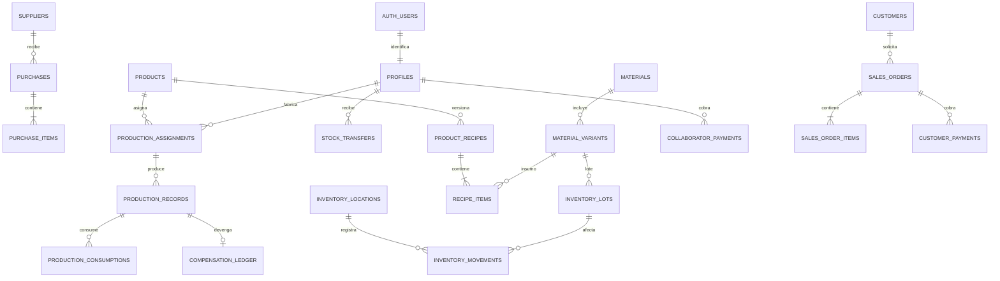

# Arquitectura y plan de implementaci?n

## Alcance y decisiones

Aplicaci?n Next.js App Router con TypeScript estricto y Tailwind, Supabase Auth mediante cookies SSR, PostgreSQL y RLS. La identidad se verifica en el servidor con `auth.getUser()`; el rol y estado se obtienen de la tabla protegida, nunca de metadatos del navegador. La ?nica tabla de esta fase es `profiles`. Su escritura queda reservada al propietario de la base; un administrador puede leer perfiles pero no modificar roles mediante la API. La funci?n `is_active_admin` consulta exclusivamente el usuario autenticado, tiene `search_path` vac?o y evita recursi?n RLS. Ning?n dato empresarial es accesible a an?nimos. La aplicaci?n no usa claves privilegiadas.

El dise?o completo es una propuesta para migraciones posteriores, no tablas ya operativas. Dinero y cantidades usar?n `numeric`; fechas de negocio se interpretar?n en America/Argentina/Buenos_Aires, moneda inicial ARS. Los registros confirmados ser?n inmutables y se corregir?n con movimientos compensatorios. Idempotencia mediante claves ?nicas por operaci?n; restricciones, bloqueos y transacciones en funciones SQL para evitar dobles consumos. Los datos hist?ricos guardar?n receta, tarifa y costo aplicado.

## Modelo previsto

El inventario tendr? ubicaciones de dep?sito, tr?nsito y custodia; una transferencia mueve saldo sin consumirlo. Los movimientos y lotes guardar?n origen y costo hist?rico. El peso de varillas hologr?ficas conservar? el dato original y las unidades estimadas se redondear?n hacia abajo; las varillas de fibra y sus segmentos ser?n materiales separados unidos por una transformaci?n. Las recetas versionadas permiten 3 g por pluma como valor inicial configurable. El consumo se contabiliza en gramos, no en potes enteros.

La producci?n bloquear? la asignaci?n y saldos pertinentes en orden estable, validar? disponibilidad, tomar? snapshots de receta y tarifa y registrar? consumo y devengamiento en una transacci?n idempotente. Se distinguir? producci?n terminada de recepci?n f?sica. Los pagos y cobros ser?n hechos ?nicos vinculados a sus movimientos de caja; compras no equivalen a costo de ventas. La valoraci?n propuesta es promedio ponderado m?vil, con snapshots de costo y trazabilidad de lotes; el m?todo exacto de asignaci?n a ventas queda por dise?ar antes de informar rentabilidad.

## Fases y dependencias

1. **Fundamentos:** proyecto, autenticaci?n, perfiles, RLS y estructura visual. La administraci?n de usuarios desde la aplicaci?n a?n est? pendiente; pruebas de integraci?n requieren Supabase local.
2. **Inventario:** unidades y variantes, proveedores, compras, lotes, ubicaciones, movimientos, transferencias y confirmaciones. Primero definir libro de movimientos, saldos bloqueables y reversi?n.
3. **Producci?n:** productos y recetas versionadas, asignaciones, operaci?n at?mica de producci?n, consumo, entrega y reversi?n.
4. **Colaboradoras:** vistas propias, tarifas, devengamientos y pagos idempotentes; se apoya en producci?n y transferencia.
5. **Pedidos y finanzas:** clientes, pedidos, cobros, caja y costos, con reservas y v?nculo a producci?n.
6. **Estabilizaci?n:** indicadores reales, proyecciones, exportaciones, auditor?a, pruebas integrales y despliegue.

Cada nueva tabla expuesta debe activar RLS, conceder solo permisos necesarios y contar con pruebas positivas y negativas. Ninguna fase debe habilitar operaciones sensibles sin probar transacciones, aislamiento e idempotencia. Se requieren decisiones comerciales posteriores sobre asignaci?n de gastos, reservas y criterio de rentabilidad; no se inventaron valores.
